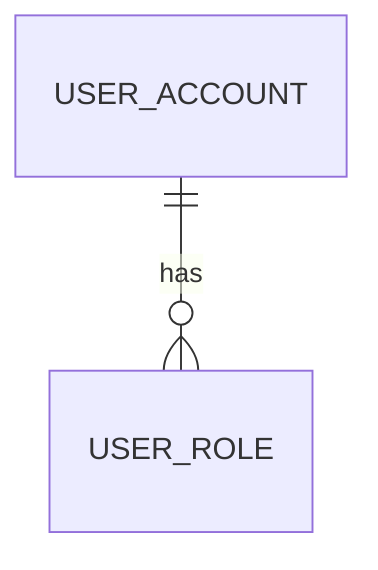

# USER_ROLE Table Design

## Document Information

| Item | Value |
|------|-------|
| Project | Nail SaaS |
| Status | Included in Rebuild DDL — Pending Live Schema Verification |
| Date | 2026-11-07 |

---

## Purpose

`USER_ROLE` 用於明確記錄帳戶可使用的系統角色，供後端登入身分摘要及 API 授權判斷使用。此表是角色指派表，不是逐項 API 權限清單；後端依固定角色及其程式化政策執行授權。

目前登入後需要區分一般會員與美甲師。使用者可以同時有多個角色，因此採用一個帳戶對多筆角色指派，而不是在 `USER_ACCOUNT` 增加單一角色欄位。

角色集合已依需求確認，且設計已納入重建 DDL；依 ADR-0002，Oracle `NSAS` 現行 Schema 仍是正式環境資料模型權威。此表尚未套用或驗證於現行資料庫。

正式重建腳本中的 DDL 位於 [NSAS-Schema-Rebuild.sql](NSAS-Schema-Rebuild.sql)。獨立 SQL 片段見 [USER-ROLE-Proposal.sql](USER-ROLE-Proposal.sql)，供單表檢視；正式環境套用仍需建立 migration。

## Relationship

`MANICURIST` 仍保存美甲師的店家歸屬、顯示名稱、店內職務及接單狀態。`USER_ROLE` 的 `MANICURIST` 是帳戶層級的系統角色，不能取代 `MANICURIST.ROLE`（OWNER、ADMIN、STAFF）或 `MANICURIST.STATUS`。

## Proposed Columns

| Column | Oracle Type | Nullable | Description |
|--------|-------------|----------|-------------|
| `USER_ID` | `NUMBER` | No | 對應 `USER_ACCOUNT.USER_ID` 的帳戶識別碼。 |
| `ROLE_CODE` | `VARCHAR2(30)` | No | 系統角色代碼：`MEMBER`（一般用戶）、`MANICURIST`（美甲師）、`SHOP_MANAGER`（店長／老闆）、`ADMIN`（系統管理員）。 |
| `IS_ACTIVE` | `NUMBER(1)` | No | 指派是否有效：`1` 有效、`0` 停用。 |
| `GRANTED_BY_USER_ID` | `NUMBER` | Yes | 授予此角色的操作者；系統建立的初始角色可為 null。 |
| `CREATE_TIME` | `TIMESTAMP` | No | 此角色指派建立時間。 |
| `UPDATE_TIME` | `TIMESTAMP` | No | 此角色指派最後異動時間。 |

### Proposed Constraints

- 複合主鍵：`(USER_ID, ROLE_CODE)`，同一帳戶同一角色只保留一筆指派。
- `FK_USER_ROLE_USER`：`USER_ID` → `USER_ACCOUNT.USER_ID`。
- `FK_USER_ROLE_GRANTED_BY`：`GRANTED_BY_USER_ID` → `USER_ACCOUNT.USER_ID`。
- `CK_USER_ROLE_CODE`：`ROLE_CODE IN ('MEMBER', 'MANICURIST', 'SHOP_MANAGER', 'ADMIN')`。
- `CK_USER_ROLE_ACTIVE`：`IS_ACTIVE IN (0, 1)`。
- 不使用 cascade delete；帳戶刪除／停用政策應由帳戶生命週期設計決定。

角色集合依需求確認為四種：`MEMBER`、`MANICURIST`、`SHOP_MANAGER`、`ADMIN`。店長與老闆共用 `SHOP_MANAGER`，此設計不區分兩者權限。各角色何時授予，以及 `MANICURIST`／`SHOP_MANAGER` 是否須先建立相應業務資料，仍需在流程規格中定義。

## Authorization Rules

- Email 驗證成功後取得 `MEMBER`；不可由註冊 Request 指定角色。
- 成功建立店家及其 Manicurist 關聯後取得 `SHOP_MANAGER` 與 `MANICURIST`。
- 成功加入店家並建立 Manicurist 關聯後取得 `MANICURIST`，且保留帳戶既有角色。
- `MANICURIST`、`SHOP_MANAGER`、`ADMIN` 必須由受信任的後端流程授予；不得採用前端傳入角色或使用者自行更新角色。
- 登入／`/user/me` 可以回傳啟用中的角色代碼供前端做頁面導向，但每個受保護 API 必須由後端重新驗證角色及資源歸屬。
- 角色集合的授予、撤銷及稽核流程尚未由 User Flow/API 文件定義；在流程補齊前，不能新增可由一般使用者呼叫的角色管理 API。
- `IS_ACTIVE = 0` 會在下一個 API request 的 JWT 驗證階段停止載入該角色；Access Token 本身仍有效。

## Query and Performance

主要讀取情境是登入或 `/user/me` 以 `USER_ID` 取得啟用角色。複合主鍵以 `USER_ID` 為首欄，可支援此查詢；目前不提議額外索引。角色指派變更低頻，複合主鍵亦可阻止重複授予。

授權查詢應批次取得目前使用者角色並在單一請求中重用，避免每項資源操作重複查詢造成 N+1。若將來需反向列出某角色所有帳戶，再依實際 SQL、資料量及執行計畫評估 `(ROLE_CODE, IS_ACTIVE, USER_ID)` 索引。

## API and Flow Impact

- `Authentication.md`：登入／驗證回應需定義角色摘要欄位及其語意。
- `User.md`：`GET /user/me` 可定義啟用角色清單。
- `Core-Flows.md`：需補角色授予、停用、撤銷及美甲師加入店家的關聯流程。
- 後端 Security/Service 層需依角色做授權；前端導向只屬於體驗行為。

上述 API 與流程目前仍待設計，本提案不代表它們已核准。

## Migration and DDL

正式環境套用前需新增可重複部署的 migration，建立此表、約束及欄位註解，並同步維護 Table Catalog、索引文件、API 規格及安全 ADR。資料回填須先確認既有 `MANICURIST.USER_ID` 與帳戶資料的一致性；不能直接假設所有 `MANICURIST.ROLE = 'OWNER'` 都代表帳戶層級 `SHOP_MANAGER`。

## Open Decisions

1. 確認一個帳戶可否同時管理多家店，以及 `SHOP_MANAGER` 是否需帶店家範圍。若需資源範圍，本表目前的角色代碼不足以表示店家授權，需重新設計關聯模型。
2. 確認角色授予／撤銷操作人及稽核保留方式。

## Change History

| Date | Change |
|------|--------|
| 2026-11-07 | 建立角色指派表設計及獨立 Oracle DDL 片段。 |
| 2026-11-07 | 依需求確認角色為 MEMBER、MANICURIST、SHOP_MANAGER、ADMIN；店長與老闆共用 SHOP_MANAGER。 |
| 2026-11-07 | 將 USER_ROLE 建表與註解加入 NSAS Schema 重建 DDL；尚未驗證或套用於現行資料庫。 |
